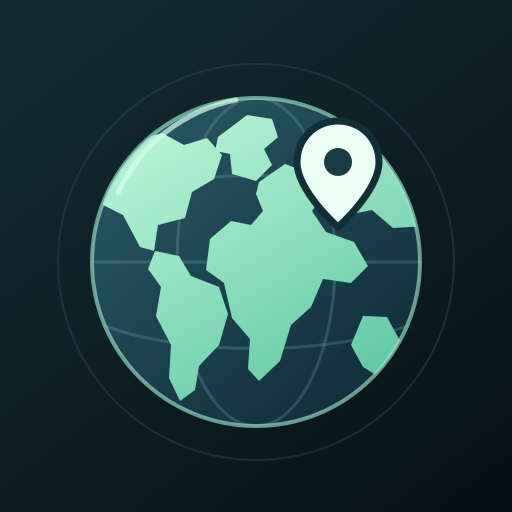

# Atlas



[Play Atlas](https://kmarchais.github.io/geography-game/) in your browser, or install the Android app. Both use the same interface and shared ranking.

Find all 195 countries on a 3D Earth. You have one guess per country, and every answer advances immediately. Skip islands you cannot find. The clock runs continuously; rankings sort by percentage correct, then by the time of the last correct answer.

The [exact quiz list](docs/country-list.md) is the 193 UN member states plus Palestine and the Holy See, represented geographically by Vatican City. This is a membership-based selection, not a claim about universal diplomatic recognition.

Drag to rotate, scroll or pinch to zoom, and tap land to answer. Small-country markers help with islands. Keyboard controls are arrow keys, +/−, and Enter to select the center. Help contains the instructions and map credits.

## Run locally

Atlas follows the primary system or browser language: French for `fr` locales, English otherwise. Country names, controls, account forms, messages, and Help use the same language on web and Android. Usernames and report text stay as entered.

Interface translations live in `src/globe/locales/en.json` and `fr.json`, with shared typed keys in `src/globe/i18n.ts`. Add both translations when adding a message. Tests compare keys and interpolation parameters and verify French names for all 195 countries. Country IDs and scoring never depend on translated names. Run `bun run data:names` to regenerate the checked-in French names from the pinned source.

Use Node 24.15 or newer and Bun 1.2.20.

```sh
bun install --frozen-lockfile
```

Start `bun run ranking` in one terminal and `bun run dev` in another. Open http://localhost:3000/geography-game/. Vite proxies `/atlas-api` to the ranking service on loopback port 4178. WebGL 2 is required. Globe, country data, and fonts are local assets. Sharper imagery downloads as you zoom.

The ranking service stores `.local/atlas.sqlite`. Back it up with SQLite's backup API or while the service is stopped. Keep it when updating web assets. `ATLAS_DB`, `ATLAS_PORT`, and comma-separated `ATLAS_ALLOWED_ORIGINS` configure the service.

## Host the game

Build with `bun run build`, then keep `bun run ranking` running independently of the build terminal. Serve `dist` over HTTPS and proxy `/atlas-api` to `http://127.0.0.1:4178`. Allow the exact HTTPS origin through `ATLAS_ALLOWED_ORIGINS`.

For Tailscale Serve, configure a static route to `dist` at `/geography-game` and a proxy route at `/atlas-api`. Keep machine addresses in local configuration. Players need access to the tailnet and the host must stay awake. Public hosting requires a public HTTPS origin and the same API route.

The original GitHub Pages website uses the `Build and Deploy` workflow. Set the `ATLAS_API_URL` repository variable to the reachable HTTPS API endpoint, select GitHub Actions as the Pages publishing source, and run the workflow on the branch to publish. It uploads a build artifact instead of committing generated assets or machine addresses to `gh-pages`. Pull requests run checks without publishing or contacting the live ranking API. A `404.html` app shell handles old route bookmarks.

For a separately hosted API, add the website origin to both `ATLAS_ALLOWED_ORIGINS` and `ATLAS_CROSS_SITE_ORIGINS`. Cross-site account cookies are Secure, HttpOnly, SameSite=None, and Partitioned, so modern browsers can preserve account state while blocking ordinary third-party cookies. Keep the API host running for accounts and shared rankings; the static game stays on GitHub Pages.

Each guest identity contributes its best completed run to the top 20. Names do not reserve accounts. Clearing local storage creates another identity. The server checks the deck, answer order, country membership, and time bounds, and calculates correctness. Client timing remains trusted within those bounds, so this is a practice leaderboard, not a fraud-resistant competition.

If the API is unavailable when a run starts, play continues unranked. Completed runs stay in the device's personal best list when storage is available. Answer uploads retry transient failures twice with the same request. Exhausted retries leave the shared result unconfirmed and preserve the local score.

## Verify changes

```sh
bun run type-check
bun run test
bun run test:ranking
bun run lint:check
bunx playwright install chromium
bun run test:globe
```

The globe suite starts its own in-memory ranking service and tests production assets in desktop, Pixel, and tablet profiles. It covers canvas selection, immediate advancement, touch rotation and pinch, continuous timing, a complete 195-country run, lost acknowledgements after server commit, local bests, offline behavior, accessibility, and idle rendering. Emulation does not replace physical testing.

Web and Android use the same Atlas screen. Other modes and settings are hidden; old mode bookmarks redirect to Atlas, including offline after installation. Their source remains in the repository. The old `bun run test:e2e` suite describes the retired interface. Some legacy component and external-data unit tests remain skipped. `RUN_REMOTE_TESTS=true` enables external-data checks.

## Connect a Google account

Set `GOOGLE_CLIENT_ID` on the ranking service to your Google OAuth web client ID. Register each website origin in that client's authorized JavaScript origins. For Android, register an Android OAuth client in the same Google project using the package ID and the installed app's signing-certificate SHA-1. The native account chooser uses the web client ID supplied by the server. No Google client secret is needed.

Google sign-in is optional. A confirmed session replaces the Google button with a connected-account card and removes the guest name field. **Edit profile** lets you choose a username, your Google photo, a preset avatar, or an uploaded photo. Your username is independent of your Google name and updates the names shown for your account's scores. An interrupted or unconfirmed connection keeps the guest interface and displays its status; choosing a Google account alone does not prove that Atlas is connected.

The server verifies the ID token and a browser-bound, expiring nonce before issuing an opaque session cookie. Session cookies are Secure and HttpOnly. The SQLite database stores account identifiers, chosen usernames, profile pictures or avatars, hashed session tokens, and scores; it does not store Google passwords, ID tokens, or email addresses. Google photos use the URL from the verified token. Uploads become cropped 256-pixel JPEG thumbnails; the original photo and its metadata are not uploaded. A connected player's profile and best score are shared across web and Android.

After completing an online guest run, you can sign in from the results screen to attach that run to your account. A private claim token proves ownership; failed transfers can be retried without replaying. Older guest runs and offline scores are not automatically imported. See [Google setup and validation](docs/google-sign-in.md).

If Android returns to Atlas after account selection without completing sign-in, check the Android OAuth client's package and signing fingerprint in the same Google project as the web client. Google documents that a cancellation exception can also indicate an authorization or configuration problem. Atlas reports that the connection did not complete instead of showing a connected account. See [Credential Manager troubleshooting](https://developer.android.com/identity/sign-in/credential-manager-troubleshooting-guide).

For a same-origin host, proxy the API under the website origin. For GitHub Pages, use the separately hosted API and explicitly allow the website origin. `ATLAS_ALLOWED_ORIGINS` controls credentialed CORS. `ATLAS_CROSS_SITE_ORIGINS` explicitly selects origins needing SameSite=None cookies, defaulting to Capacitor's `https://localhost`. Add a custom native origin to both settings if you change Capacitor's hostname. The Android WebView accepts these cookies; other browsers can impose additional third-party-cookie restrictions. Sign out revokes the current session.

The old Google client ID can be reused, but the original Railway application is no longer reachable. Atlas uses the existing ranking SQLite database for its accounts. This does not migrate data from the old Railway database.

## Build Android

Use Java 21, Android SDK 36, Node 24.15 or newer, and the checked-in Gradle wrapper. Set `JAVA_HOME`, `ANDROID_HOME`, and `VITE_ATLAS_API_URL` to a reachable HTTPS ranking endpoint. Native builds fail if that endpoint is missing.

```sh
bun run build:android
cd android
./gradlew assembleDebug
```

On Windows use `gradlew.bat`. Install `android/app/build/outputs/apk/debug/app-debug.apk` with `adb install -r` or Mobile MCP. The display name is Atlas; the package ID remains `com.kmarchais.orbit` to preserve updates and data. Core assets are bundled for offline play. Rankings and detailed imagery need connectivity. Store releases still need release signing and an Android App Bundle.

Manual runs of `Build and Deploy` also compile Android and retain the APK, source commit, and input manifest as the `atlas-android-debug` artifact. Hosted runners use their own temporary debug signing key. Re-sign that APK locally with the existing development key before updating an installed development app; keep signing keys off the runner. This artifact is not a Play Store release.

## Test through MCP

`.mcp.json` provides pinned Playwright MCP desktop and phone profiles, plus Mobile MCP for physical devices. Install Android platform-tools and pair the phone through Wireless debugging. Check `adb devices` before testing. Keep device addresses and pairing credentials outside version control. Stay awake keeps a charging phone available; it does not schedule tests or bypass the lock screen.

## Update the icon

Edit `public/atlas.svg`, then run:

```sh
bunx playwright install chromium
bun run icons
```

The script generates PWA icons, the favicon, the Apple touch icon, Android launcher images, and legacy splash images from the same vector. Android 13 and newer also use a separate monochrome vector for themed launcher icons. Keep the globe and pin inside the adaptive icon's safe area. Rebuild and reinstall the APK to update its launcher icon.

## Report a bug

Choose **Menu → Report a bug** in the website or Android app. Guests can report problems too. The form explains that the description will be public and shows the technical context being sent: platform, build version, viewport, and active country. It does not collect login tokens, account photos, email addresses, or machine URLs.

The API saves each report in the existing SQLite database before publishing an issue in `kmarchais/geography-game`. A background publisher retries outages; stable report IDs and an issue-body marker prevent duplicate submissions and recover a lost GitHub response. Report text stays in the form if the API itself cannot be reached.

The API host needs GitHub CLI authenticated as `kmarchais` with permission to create issues. Its existing credential store is used; no GitHub token goes into the app or website. The publisher verifies the active account before posting and passes report text as JSON input rather than shell commands. Trial limits allow three reports per player per hour and twenty reports and automatic issue publications per day. The publisher scans the hundred most recent repository issues when recovering an uncertain submission; increase that window if repository traffic requires it.

## Code ownership

- `src/globe/game.ts`: rules, score ordering, and local best validation.
- `src/globe/ranking.ts` and `server/ranking.mjs`: HTTP client and SQLite service.
- `server/reports.mjs` and `src/components/BugReportDialog.vue`: durable bug reports and automatic GitHub issues.
- `src/globe/geography.ts`, `detail.ts`, and `terrain.ts`: picking and imagery.
- `src/components/EarthGlobe.vue`: Three.js and input.
- `src/views/GlobeGame.vue`: challenge UI and session lifecycle.
- `tests/globe` and `tests/server`: browser and HTTP integration tests.

Read [asset provenance](docs/assets.md), [the original architecture review](docs/project-review.md), and [Atlas validation](docs/atlas-validation.md). The append-only [decision trail](docs/decisions.tsv) records the redesign. Do not regenerate geography during a normal build.

Repository instructions for coding agents are in [AGENTS.md](AGENTS.md).
